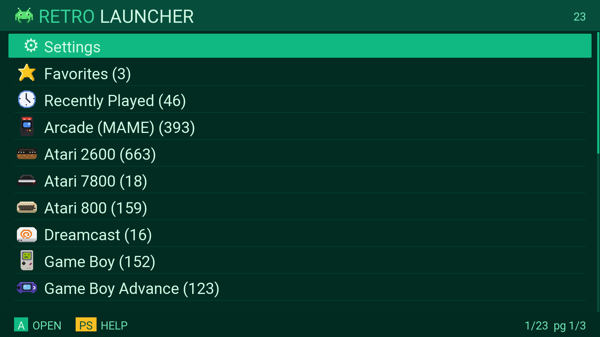
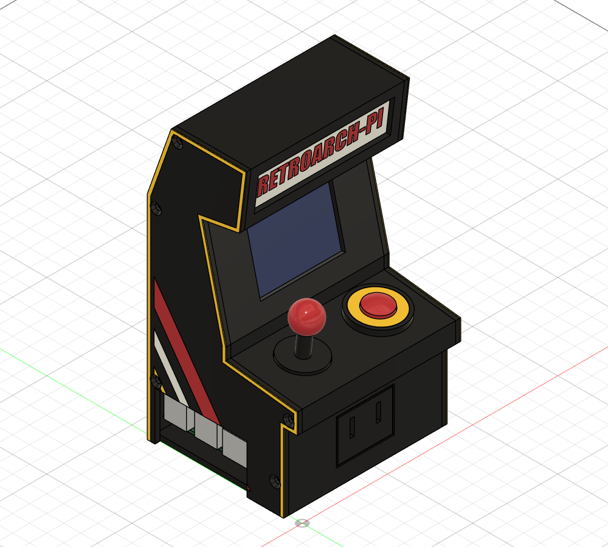
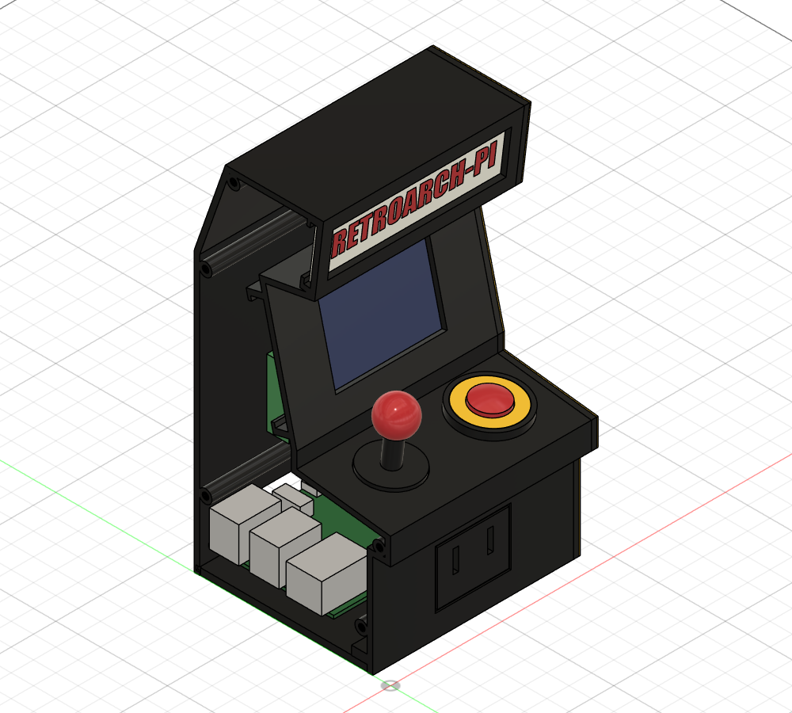

# RetroArch-PI

Retro gaming console firmware for small ARM boards, on **HDMI at 1080p**, and
for the **GPi Case 2** handheld on its own 640×480 LCD as well.
It boots straight into a custom DRM/KMS launcher; RetroArch runs on the GPU
with 21 emulator cores, from NES to PSP and Dreamcast.



Buildroot 2026.02.3. One source tree builds every supported board: everything
above the board layer (launcher, RetroArch, cores, init scripts, tools) is
shared, so a fix made for one board reaches all of them.

## Supported boards

| Board | SoC / GPU | RAM | Status |
|---|---|---|---|
| **Orange Pi Zero3** | Allwinner H618, 4× Cortex-A53, Mali-G31 MP2 | 2 GB LPDDR4 | **Working.** The reference board: most settings were first measured on it |
| **KickPi K2B V2.2** | Allwinner H618, 4× Cortex-A53, Mali-G31 MP2 | 2 GB DDR3 | **Working.** HDMI video and audio, GPU, Gigabit Ethernet, ROM card, power button (clean shutdown). Same SoC as the Zero3, so the emulation results carry over |
| **Raspberry Pi 4** | Broadcom BCM2711, 4× Cortex-A72, V3D 4.2 | 1–8 GB | **Working.** Menu ~9 s after power-on; game tests pass (Dreamcast, N64, PlayStation, PSP). Power button on GPIO3 (off and on), SPI status LCD, and its own [arcade cabinet](#the-arcade-cabinet-raspberry-pi-4). See [docs/boards/rpi4.md](docs/boards/rpi4.md) |
| **Retroflag GPi Case 2** + Compute Module 4 Lite | Broadcom BCM2711, 4× Cortex-A72, V3D 4.2 | 1 GB tested | **Working, docked and handheld.** Docked: HDMI and the dock's USB ports. Handheld: the 3.0" 640×480 LCD, built-in controls, speaker and headphone jack, battery. Menu ~10 s after power-on. See [below](#the-gpi-case-2-handheld) and [docs/boards/gpicase2.md](docs/boards/gpicase2.md) |

The Allwinner boards run mainline Linux 6.18.53 with Armbian's HDMI patches;
the Pi 4 and the GPi Case 2 run the Raspberry Pi kernel (`rpi-6.18.y`,
6.18.57), whose firmware overlays they use.

**KickPi K2B: only the V2.2 is supported** (DDR3, Maxio MAE0621A Ethernet PHY).
The V1 (LPDDR4, RTL8211F) needs a different U-Boot DRAM setup. eMMC is not
supported; the K2B boots and runs from microSD.

## Setups

| | |
|---|---|
| **Display** | HDMI 1920×1080 (1280×720 as a build option). The launcher picks the matching TV mode and scales its layout to it. On the Pi 4, an optional 2.4" SPI LCD shows a status page (below); games stay on HDMI. On the GPi Case 2, HDMI when docked, else the case's 640×480 LCD, chosen at boot |
| **Controller** | DualShock 3, wired, or over Bluetooth via a USB dongle (the onboard Wi-Fi/BT is not used). On the GPi Case 2, its built-in controls as well |
| **Storage** | One microSD card: system partition plus an **exFAT ROM partition**, readable and writable from Windows. Boot the card once after flashing: the console creates a folder per system and a README on it. Saves, save states and the shader cache live on the ROM partition; nothing is written to the system partition during play |
| **Network** | Onboard Ethernet, for SSH access during development (GPi Case 2: a USB Ethernet adapter in the dock). Not needed to play |
| **Power** | Zero3: power off from the launcher's Settings. K2B: the inner button shuts down cleanly; power on by replugging. Pi 4: a button on GPIO3 shuts down cleanly **and** powers back on. GPi Case 2: the power switch shuts down cleanly and the case then cuts its power |

## What it does

| | |
|---|---|
| **Systems** | NES, SNES, Game Boy / Color / Advance, Genesis, Master System, Game Gear, PC Engine, SuperGrafx, Atari 2600 / 7800 / 800 / 5200, ZX Spectrum, Neo Geo / CPS / arcade, Doom, PlayStation, Nintendo 64, **PSP** (PPSSPP), **Dreamcast** (Flycast) |
| **GPU** | Mali-G31 via Mesa panfrost (H618), V3D via Mesa v3d (Pi 4, GPi Case 2); GLES 3.1. RetroArch `gl` driver on KMS/GBM |
| **Audio** | HDMI (GPi Case 2 undocked: its speaker and headphone jack), with a software volume control the launcher and in-game hotkeys share |
| **Launcher** | Jump-to-letter, favourites, recents, save-state slots and a quick start from a bookmarked state, search, themes, **cover art** next to the game list. Full game titles for arcade (from the emulators' own game lists) and PSP (read from the disc). A tap of PS shows every control |
| **CPU** | Full clock during games (no audio dropouts from late clock ramps); the menu lets the clock drop |

Measured on the H618 boards: NES, PlayStation and Nintendo 64 run smoothly; PSP
is playable, including heavy titles like Assassin's Creed Bloodlines (99% speed
with auto frameskip); Dreamcast runs Sonic Adventure 2 at roughly 85–90%,
limited by one CPU core rather than the GPU. The Pi 4's A72 cores are roughly
twice as fast per clock; its game tests run at 99–101% speed.

**Cover art** is fetched onto the ROM card by
[`scripts/fetch-thumbnails.py`](scripts/fetch-thumbnails.py) from the libretro
thumbnail server. Games are matched by name and, when the file name is not the
official one, by the ROM's checksum against the libretro database. The artwork
is never stored in this repository.

## The arcade cabinet (Raspberry Pi 4)

| | |
|---|---|
|  |  |

A 96 × 88 × 165 mm mini arcade cabinet, printed in four colours (Snapmaker U1),
in [`hardware/rpi4-arcade-case/`](hardware/rpi4-arcade-case/):

- a **2.4" ST7789V SPI LCD** in the screen position. It shows a status page:
  the game being played with its cover art, IP address, CPU temperature, clock
  and per-core load, uptime (`lcdinfo`);
- a working **power button** (GPIO3: clean shutdown and power on), a decorative
  joystick, a 30 mm exhaust fan, and coin slots that are the air intake;
- two screw-on side doors with inlaid side art, a removable tray for the Pi,
  modeled screw threads, and slide-in rails for the LCD and the marquee.

The whole design is one parametric Fusion API script, `arcade_case.py`, which
also exports the STEP, 3MF and STL files (one body per colour) and checks the
parts against models of the Pi, LCD, fan and switch. Wiring, printing and
assembly: [its README](hardware/rpi4-arcade-case/README.md).

## The GPi Case 2 handheld

A Compute Module 4 Lite (the Pi 4's SoC, booting from the SD card in the
cartridge) in Retroflag's GPi Case 2. The same image runs both ways:

- **Handheld**: the menu and games on the 3.0" 640×480 LCD, the built-in
  controls (an Xbox 360-style USB pad), sound on the case's speaker or
  headphone jack, and a battery icon with a low-battery warning (the case has
  no fuel gauge, so the warning comes from the under-voltage alarm).
- **Docked**: the menu and games on the TV at 1080p with HDMI sound, pads in
  the dock's USB ports, and SSH over a USB Ethernet adapter. The case keeps its
  LCD off while docked.

The screen and the sound output are chosen at boot: after docking or undocking
a running case, restart it to switch.

## Images

Ready-to-flash images and cover art are shared separately (not in this
repository): *link to follow*. Flash with Etcher or Rufus; see
[docs/flashing.md](docs/flashing.md). You supply your own ROMs and BIOS files.

## Why the H618 kernel carries patches

Mainline Linux still has no HDMI for the H616/H618. The display engine driver
is there; the HDMI PHY, the TV timing controller and every display node are
not. Armbian carries Jernej Škrabec's refactor, which does all of that. Those
patches are vendored from Armbian unmodified, pinned to one commit. See
[`buildroot-external/board/h616/patches/linux/README.md`](buildroot-external/board/h616/patches/linux/README.md),
and each board's own `patches/README.md`.

## Building

See **[BUILDING.md](BUILDING.md)**. In short: WSL2 or Linux, ~30 GB of disk
per board, a few hours for the first build. LLVM is part of the build, because
Mesa's panfrost needs it.

```bash
scripts/build.sh zero3        # Orange Pi Zero3
scripts/build.sh k2b          # KickPi K2B V2.2
scripts/build.sh rpi4         # Raspberry Pi 4
scripts/build.sh gpicase2     # GPi Case 2 + CM4 Lite
```

## Testing

[docs/test-plan.md](docs/test-plan.md) is the release checklist. Two scripts do
the work on a board over SSH, playing on its TV:

- `scripts/release-test.sh <board>`: a sweep that starts a few games per heavy
  emulator and checks they load, stay up and keep their sound at full speed.
- `scripts/game-test.sh <board>`: real gameplay from a save state, driven by a
  virtual DualShock 3, with screenshots, speed and sound level checked.

## Repository layout

```
buildroot-external/
  configs/              one defconfig per board
  package/              shared: RetroArch + cores (and their patches), launcher, tools
  board/common/         shared: rootfs overlay, kernel fragment, post-build/post-image
  board/h616/           shared by the Allwinner H616/H618 boards: kernel patches,
                        kernel and U-Boot fragments, genimage, boot-chain checks
  board/bcm2711/        Raspberry Pi 4 family (Pi 4, CM4): kernel fragment, boot-chain checks
  board/opi-zero3/      Zero3 only: DT patches, extlinux.conf, PHY driver
  board/kickpi-k2b/     K2B only: DT + PHY patches, U-Boot (DDR3), extlinux.conf
  board/rpi4/           Pi 4 only: config.txt, cmdline.txt, genimage, fstab, LCD init
  board/gpicase2/       GPi Case 2 only: config.txt (LCD, power switch), cmdline.txt,
                        genimage, power latch
launcher/               the launcher (C, DRM/KMS + SDL2_ttf)
tools/                  volumed (volume, power button), lcdinfo (status LCD),
                        inject-input / inject-pad (virtual keyboard and DS3), core-info
hardware/               the Pi 4 arcade cabinet (Fusion script, STEP/3MF/STL)
scripts/                build.sh, board.sh, sync-rootfs.sh <board>; boards.sh (the board table);
                        release and game tests; fetch-thumbnails.py; gen-*.py
docs/                   flashing, test plan, per-board notes, development logs
```

## Licence

GPL-2.0-or-later. See [LICENSE](LICENSE) and [NOTICE](NOTICE).

Buildroot, Linux, U-Boot, TF-A, Mesa, RetroArch and the libretro cores are
fetched from their own upstreams at pinned revisions and remain under their
own licences. No ROMs, BIOS images or cover art are distributed here.
