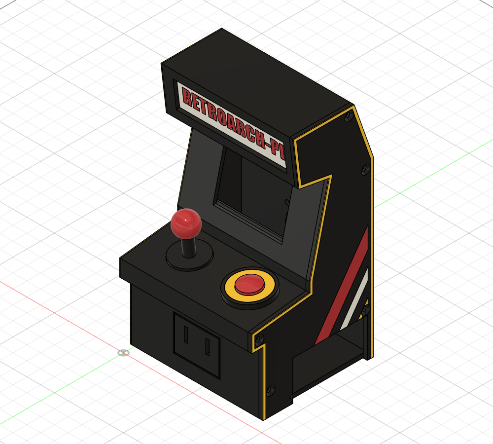

# Raspberry Pi 4 mini arcade cabinet

A 96 × 88 × 165 mm (W × D × H) arcade cabinet for the Pi 4, printed in 4 colours on the
Snapmaker U1. It has:
- a 2.4" ST7789V SPI LCD (240×320, mounted landscape);
- a working power button on GPIO3 (off and on);
- a 30 mm exhaust fan;
- a decorative joystick and a coin door (its two coin slots are the air intake).

| | |
|---|---|
|  |  |

## Files

| Path | What |
|---|---|
| `arcade_case.py` | **The source.** A Fusion API script: every dimension is a parameter at its top. It builds all parts, checks them against reference models of the Pi 4, LCD, fan and switch (`clashes: 0`), and writes every file below |
| `step/<part>.step` | One STEP per printed part, **in print orientation** (first layer at z = 0), one body per colour |
| `step/Assembly_with_references.step` | The assembled cabinet (Z up) with the reference models (`REF_*`, not printed) |
| `3mf/<part>.3mf` | Same parts as 3MF, one named object per colour (load as *one object with parts*) |
| `stl/<body>.stl` | One STL per body, for slicers that want them |
| `rpi4-arcade-case.f3d` | Fusion archive of the generated design |
| `preview/` | Screenshots |

To change something, edit the parameters in `arcade_case.py` and run it again: in Fusion,
Utilities → Scripts and Add-Ins, or through the Fusion MCP. Each run closes the design the
previous run made, rebuilds everything and rewrites the exports.

## Parts and colours

Load the U1 with **black, yellow, red and white**.

| Part | Colours | Print as exported (bed face) | Approx. size |
|---|---|---|---|
| Core (walls + left side) | black, side art red/white/yellow | Left side down, art on the bed; no supports | 88 × 165 × 93 |
| SideRight | black, side art red/white/yellow | Outer face down | 88 × 165 × 3 |
| Tray | black | Bottom down | 76 × 90 × 10 |
| Marquee | white, red text | Text face down | 86 × 25 × 2.5 |
| PowerButton: housing, clip | black | Flange down (clip flat) | Ø30 × 16 |
| PowerButton: ring | yellow | Flat | Ø26 × 2 |
| ButtonCap | red | Flat bottom down | Ø19 × 9.5 |
| Joystick (stick) | black | Washer down | Ø24 × 22 |
| JoystickBall | red | Flat bottom down | Ø16 × 14 |

The coloured parts are inlays 0.6 mm deep in the bed face, so the colour changes only happen
in the first three layers (at 0.2 mm) of the side panels and the marquee.

The core prints without supports. Everything that runs across the width is part of the
extruded profile: the screw tubes, the LCD and marquee rails, and the tray ledge. Suggested
settings are PLA or PETG, 0.2 mm layers, 3 walls, 15 % infill.

## Hardware

| Qty | Part |
|---|---|
| 1 | 2.4" ST7789V 240×320 SPI module. The rails assume a module **44.0 mm tall across the rails and ≤ 4.3 mm thick from the glass front to the PCB back** (`LCD_MOD_H`, `LCD_MOD_T`). Measure yours first |
| 1 | 12 × 12 × 7.3 mm tactile switch (4 pins, 12.5 × 5 mm) |
| 1 | 30 × 30 × 10 mm 5 V fan (3010) |
| 5 | M3 × 10 countersunk self-tapping screws: right side into the tubes (pilots Ø2.5) |
| 2 | M3 × 8 countersunk self-tapping screws: tray into the front ledge |
| 4 | M3 × 12–14 screws: fan, from outside through the back wall |
| 4 | M2.5 × 6 self-tapping screws: Pi onto the standoffs (pilots Ø2.2) |
| 4 | Rubber feet Ø10 (recesses in the tray) |
| | Dupont jumper wires (female) |

## Wiring (40-pin header)

| Device | Signal | Pi pin |
|---|---|---|
| Button | one side | pin 5 (GPIO3) |
| | other side | pin 6 (GND) |
| LCD | VCC / GND | pin 1 (3.3 V) / pin 9 |
| | SCL / SDA | pin 23 (GPIO11 SCLK) / pin 19 (GPIO10 MOSI) |
| | CS | pin 24 (GPIO8 CE0) |
| | DC / RES | pin 22 (GPIO25) / pin 13 (GPIO27) |
| | BLK (backlight) | pin 12 (GPIO18), or 3.3 V for always on |
| Fan | + / − | pin 4 (5 V) / pin 14 (GND); pin 17 (3.3 V) runs it slower and quieter |

GPIO3 is the one pin that wakes a halted Pi 4 when it is pulled to GND. With
`dtoverlay=gpio-shutdown` the same button also shuts the Pi down cleanly. The firmware does
not do this yet: the image still drives HDMI, and the LCD needs its own display driver
(see `docs/boards/rpi4.md`).

## Assembly

1. **Fan:** screw it to the inside of the back wall, label facing out, so it blows air out. The
   air comes in through the coin slots and the tray vents.
2. **LCD:** from the open right side, slide the module into the rails behind the screen,
   glass towards the window. Centre the active area in the window and fix it with a dab of
   hot glue on a rail.
3. **Marquee:** slide it into its rails, text facing out. An LED strip behind it works as a
   backlight.
4. **Button:**
   - Put the switch into the pocket at the bottom of the housing, pins through the floor,
     and solder two wires to diagonal pins.
   - Drop the cap in, then press the yellow ring into the flange (a drop of glue if it is
     loose).
   - Push the housing through the deck from above, then snap the C-clip into the groove from
     inside.
5. **Joystick:** glue the stick into the recess in the deck, then press the ball onto it.
6. **Pi:** screw it onto the tray (USB-C, HDMI and audio towards the back edge with the
   tongue), then plug in the LCD, button and fan wires.
7. **Tray:**
   - Hook its tongue into the groove at the bottom of the back wall, then swing the front up.
   - The ports pass through the openings at the back and right; the SD card faces the slot
     in the left side.
   - Put in the two front screws.
8. **Right side:** five screws.

The SD card is reachable from the left side. Power, HDMI and audio come out at the back, and
USB and Ethernet on the right. To get at the Pi, take out the two tray screws and swing the
tray out.

## Design notes

- The profile and every opening are in `PROFILE` and the parameters, in a frame where X is the
  depth, Y is up and Z is the width. The exported assembly is turned Z-up.
- The LCD window shows the active area (48.96 × 36.72) plus 0.5–0.6 mm on each side, centred
  across the width. If your module's active area is off-centre on the glass, move the module
  in its rails rather than the window.
- The fit check only covers solid clashes. Plug clearance was sized by hand: the back
  opening runs 0–20 mm high, and the right opening 0–28.5 mm.
